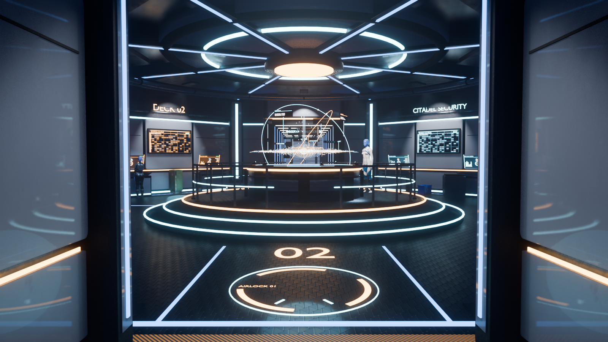
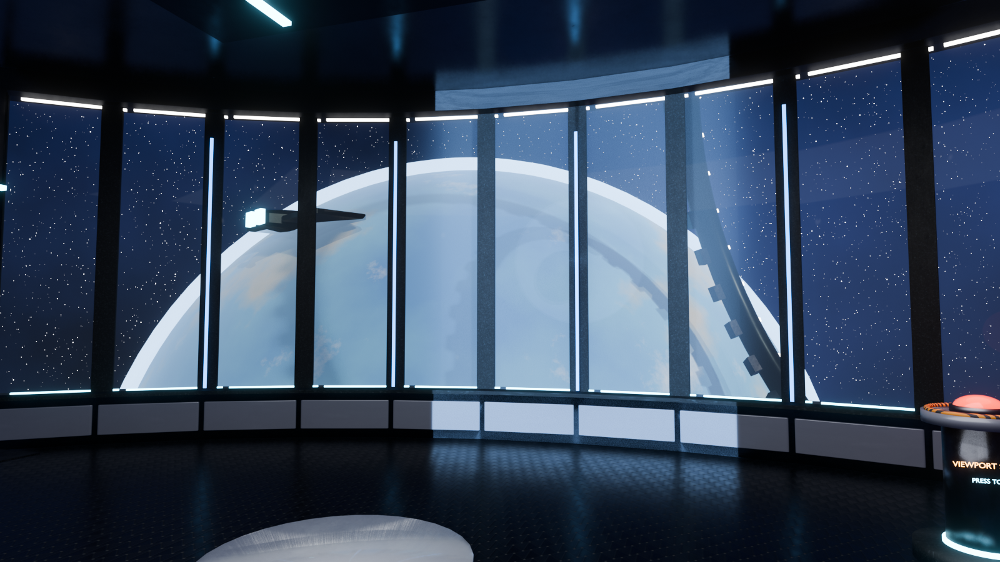

# ME Station

A walkable Mass Effect-style space station interior for Blender 5.2, generated entirely by
Python scripts: an octagonal CIC hub around an animated holographic galaxy map, three ribbed
corridors with blast doors, and an observation deck whose shutters open onto a planet, a moon,
a station ring and passing ships. Two rigged Asari characters stand in the hub with idle
animations and a press-to-talk line each. A custom first-person walker with collision runs it
inside Blender's viewport.



## Quick start

Requirements: Linux or macOS with Blender 5.2 on the `PATH` (the `blender` snap works), Python 3,
`curl`, `unzip`, and a GPU that handles EEVEE comfortably (developed on an RTX 4090).

```bash
git clone https://github.com/Dadle/me-station.git
cd me-station
./setup_assets.sh      # ~1 GB of CC0 textures and props into downloads/
./build.sh             # generates me_station.blend and me_station_demo.blend (~15 min)
./run_demo.sh          # opens the demo build in first-person walk mode
```

`run_station.sh` opens the full-quality build instead (same scene, every light shadow-casting,
live character rigs; it runs at a few fps, so use it for stills, not for walking).

### Controls

| Key | Action |
| --- | --- |
| W A S D / arrows | move |
| mouse | look |
| Shift | run |
| Alt | creep |
| Space | jump |
| E | talk to the character you are facing, or press the red shutter button |
| Esc or right mouse | leave walk mode |
| F3 → "ME Walk" | re-enter walk mode |

Environment variables for the launchers: `ME_SHOWFPS=1` shows viewport statistics and plays every
frame (the fps readout becomes the raw viewport rate); `ME_START="x,y,z,yaw_deg"` places the walker;
`ME_NATIVE_WALK=1` uses Blender's built-in walk navigation instead of the custom operator.

## What is in the scene

- **CIC hub**: white inset panels, cyan and orange light strips, pillars, vents, sconces, flanged
  conduits, cable trays, data-board wall screens, a scrolling news ticker, consoles with animated
  holographic instrument panels, lockers, crates and photoscanned props.
- **Galaxy map**: a procedural three-arm spiral haze under about 5,400 instanced stars, a core
  with halos and a beam, a mass-relay route network with travelling pulses, a pulsing selected
  system with an info card, a radar sweep with ping rings, tick marks and counter-rotating HUD
  arcs, two tilted gyroscope rings, rising data motes, floating readouts and region labels.
- **Corridors**: ribbed, with sconces, lockers, deck maps, emergency lights, approach holograms
  at each mouth, and blast doors with rotating amber beacons at the airlock and docking bay.
- **Observation deck**: twelve wide window panes on thin mullions, louvered shutters that open
  from a big red button on a pedestal, seating facing the window, and outside a sunlit planet
  with atmosphere, a moon, a rotating station ring, two frigates and a shuttle fly-by.
- **Vessa T'Rani** on the map platform (salutes, reports relay traffic) and **Liora D'Sol** at a
  console (greets you, points to the observation deck). Both are MakeHuman models with photo
  skin shifted to Asari blue, textured eyes, clothing from MakeHuman asset packs and a crest
  fitted to the skull.



## Layout

| File | Purpose |
| --- | --- |
| `build_station.py` | Generates the whole environment, lighting, holograms and animation, and appends the characters. Edit this for anything in the station. |
| `build_characters.py` | Generates `chars/<Name>.blend` with MPFB (needs `setup_makehuman.sh`). `CHARS` holds skin, outfit, poses, gesture and spoken line per character. |
| `make_demo.py` | Derives the fast demo build: bakes the characters to shape keys, strips their normal maps, merges static geometry by material, lighter shadows. |
| `walk_start.py` | The `view3d.me_walk` operator: key handling, collision BVH, gravity, overlay, character interactions, shutter button. Loaded by both launchers. |
| `setup_assets.sh` | Downloads the ambientCG texture sets and Poly Haven models into `downloads/`. |
| `setup_makehuman.sh` | Installs the MPFB extension and MakeHuman asset packs (only for regenerating characters). |
| `build.sh` | Rebuilds the scenes; `--chars` also regenerates the characters. |
| `chars/` | Committed character files, so the station builds without MakeHuman. |
| `previews/` | Renders and viewport captures. |

The generated `.blend` files and `downloads/` are not committed; `build.sh` recreates them.

## Developing

Everything is parametric, so the workflow is: edit a script, run `./build.sh` (or just the
station step, `blender -b --python build_station.py -- "$PWD/me_station.blend"`, then
`blender -b me_station.blend --python make_demo.py`), and launch.

Useful knobs in `build_station.py`:

- Materials at the top: `pbr(name, textureId, tile, tint, ...)` box-projects an ambientCG set in
  world space, so no object needs UVs.
- `HUB_R`, `CORR_W`, `LR`, `HALF`, `NP`, `SILL`: hub radius, corridor width, lounge window radius,
  arc, pane count and sill height.
- `galaxy_map()` for the centrepiece, `console()`, `wall_screen()`, `holo_panel()` for UI props,
  `corridor()` and `blast_door()` for new passages.
- Lights for the view outside: `Sun_Space` (key), `Sun_Rim`, `PlanetFill`.
- Custom properties drive runtime behaviour: `me_blind` (shutter closed/open offset),
  `me_button`, `me_blind_light`, and on characters `me_char`, with the gesture range and lines
  stored on the scene as `me_chars`.

Characters: change `CHARS` in `build_characters.py` (any folder under MPFB's `skins/`, `clothes/`
or `poses/` works), then `./build.sh --chars`. The MakeHuman "default" rig bone names are
`root, spine01..05, neck01..03, head, clavicle.L/R, upperarm01/02.L/R, lowerarm01/02.L/R,
wrist.L/R, upperleg01/02.L/R, lowerleg01/02.L/R, foot.L/R` plus fingers, toes and facial bones.

Performance notes (RTX 4090, 1920x1200): the full build runs at 3 to 4 fps, the demo at about
20 fps. Profiling showed the live MakeHuman rigs and tangent-space normal maps on deforming
meshes were the main costs, which is why the demo bakes both away; ray tracing, haze and bloom
were free. Each extra animated hologram object costs a little, photoscanned props cost almost
nothing.

## Headless rendering and testing

EEVEE renders need a display even in background mode:
`DISPLAY=:1 blender -b me_station.blend -o //previews/hero_ -f 1`.
`StartCam`, `MapCam` and `LoungeCam` are in the Camera collection.

## Assets and licences

- Code in this repository: MIT (see `LICENSE`).
- Blender extension MPFB 2 (GPL) and the MakeHuman base mesh (CC0), via `setup_makehuman.sh`.
- MakeHuman asset packs: system assets, skins01, skins03, suits02, eyebrows01, eyelashes01,
  system eye materials, system poses, poses03 (CC0); suits03 and shoes03 (CC-BY, authors named
  in each pack's `.mhclo`). Vessa's boots are "female knee boots" by punkduck (CC-BY).
- ambientCG PBR textures (CC0) and Poly Haven models (CC0), fetched by `setup_assets.sh`.
- The Mass Effect setting belongs to BioWare/EA; this is a fan-made homage, not affiliated.
